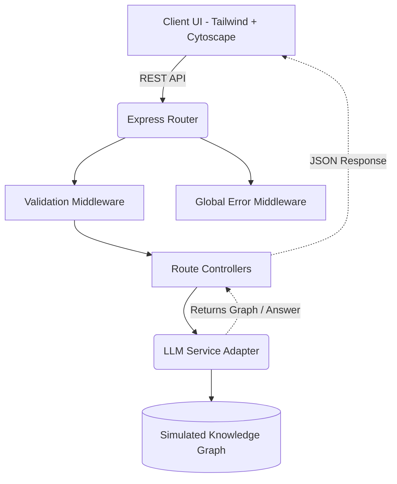

<div align="center">
  
  <h1>🚀 AI GraphRAG Vision</h1>
  <p><strong>A Next-Generation Multimodal Graph Retrieval-Augmented Generation UI</strong></p>

  [](https://nodejs.org/)
  [](https://tailwindcss.com/)
  [](https://js.cytoscape.org/)
  [](https://opensource.org/licenses/MIT)
</div>

<hr/>

## 📖 Overview

**AI GraphRAG Vision** is a cutting-edge implementation of Graph-based Retrieval-Augmented Generation (GraphRAG). It transforms unstructured documents into rich, traversable knowledge graphs and provides a futuristic, glassmorphic UI to query, reason over, and visualize complex entity relationships.

## ✨ Built With

- **Frontend:** HTML5, Tailwind CSS (via CDN for zero-build setup), Vanilla JavaScript
- **Graph Visualization:** Cytoscape.js
- **Backend Architecture:** Node.js, Express.js (Clean Architecture & Robust Middleware)
- **Design System:** Custom Dark Mode Glassmorphism with Tailwind Utility Classes

## 🔥 V3 Upgrades
- **Temporal Boundaries (valid_from / valid_until):** Filter knowledge graphs through time seamlessly.
- **Cytoscape Time Slider UI:** Intuitive temporal controls embedded within the glassmorphic overlay.
- **LLM Coordinate Anchors & Semantic Zoom:** Nodes are intelligently positioned and semantic zooming hides/shows detail based on proximity.
- **Context Chunking Limits:** Strict LLM token management simulating real-world RAG optimization.

## 🏗 Architecture

We adhere strictly to Clean Architecture principles on the backend. The API layer is decoupled from the business logic layer (`MockLLMAdapter`), ensuring modularity, testability, and rigid validation/error boundaries.



### 🧠 Why this Architecture?
- **Modularity:** Extracting the LLM interaction into `MockLLMAdapter` allows seamless swapping for real OpenAI or Anthropic SDKs in the future.
- **Robustness:** A centralized error-handling middleware catches all unhandled exceptions, ensuring the server never crashes silently and always responds with standard JSON.
- **Security & Reliability:** Strict request validation prevents malformed inputs before they hit the expensive LLM layer.

## 🚀 Quick Start

### 1. Prerequisites
Ensure you have [Node.js](https://nodejs.org/) (v16+ recommended) installed.

### 2. Installation
```bash
# Clone the repository (if applicable)
git clone https://github.com/your-username/ai-graphrag-vision.git

# Navigate into the project directory
cd ai-graphrag-vision

# Install dependencies
npm install
```

### 3. Running the Server
```bash
# Start the application
npm start
```
*The server will start on `http://localhost:4001` by default.*

## 🎨 UI/UX Trade-offs
- **Tailwind CDN:** Used to rapidly prototype the futuristic glassmorphic UI without complex build steps (Vite/Webpack), ensuring immediate accessibility and code simplicity.
- **Cytoscape.js:** Chosen over D3 for out-of-the-box physics-based layout (`cose`) and robust graph traversal animations, which are essential for visualizing "Multi-Hop Reasoning."

## 🤝 Contributing
Contributions, issues, and feature requests are welcome! Feel free to check [issues page](#).

## 📝 License
This project is [MIT](https://opensource.org/licenses/MIT) licensed.

## ?? V4 Upgrades
- **Kubernetes Ready:** Added k8s/ manifests including Deployment, Service, and Ingress for seamless container orchestration.
- **CI/CD Pipelines:** Integrated GitHub Actions workflow for automated testing and docker build simulation.
- **Interactive API Docs:** Added a static Swagger UI exposed at /api-docs mapping to the OpenAPI spec at /swagger.json.

