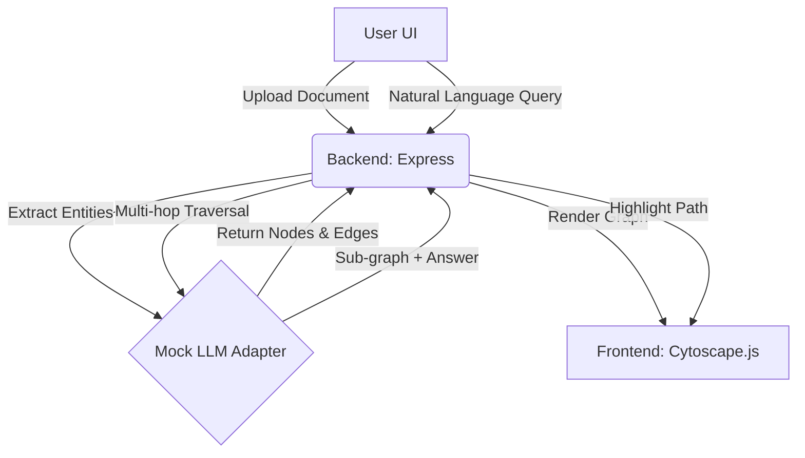

# Multimodal GraphRAG

A surreal, cutting-edge AI portfolio project demonstrating Graph-based Retrieval-Augmented Generation (GraphRAG) with visual multi-hop reasoning. 

## The "Why"
Traditional RAG relies on vector similarity, which struggles with complex, multi-hop reasoning across scattered documents. GraphRAG structures unstructured data into a Knowledge Graph, enabling the AI to explicitly traverse relationships (e.g., Company X -> acquired -> Company Y -> created -> Product Z). This project visualizes that traversal in real-time, making the AI's reasoning transparent and intuitive.

## Architecture



## Trade-offs
- **In-Memory Store vs GraphDB:** We use an in-memory graph structure for simplicity and zero-setup deployment. In a production environment with massive data, a dedicated Graph Database like Neo4j would be required.
- **Mock LLM vs Real API:** To ensure this portfolio project runs out-of-the-box without requiring API keys, we use a `MockLLMAdapter` that simulates the latency, entity extraction, and multi-hop reasoning capabilities of models like GPT-4.

## Quick Start

1. Install dependencies:
   ```bash
   npm install
   ```

2. Start the server:
   ```bash
   npm start
   ```

3. Open your browser to `http://localhost:3000`

## Features
- **Futuristic UI:** Glassmorphism panels, dark mode, smooth transitions.
- **Interactive Graph:** Beautifully rendered Knowledge Graph using Cytoscape.js. Force-directed layout.
- **Visual Reasoning:** When queried, the system visually highlights the exact path (multi-hop) it takes through the graph to synthesize its answer.
