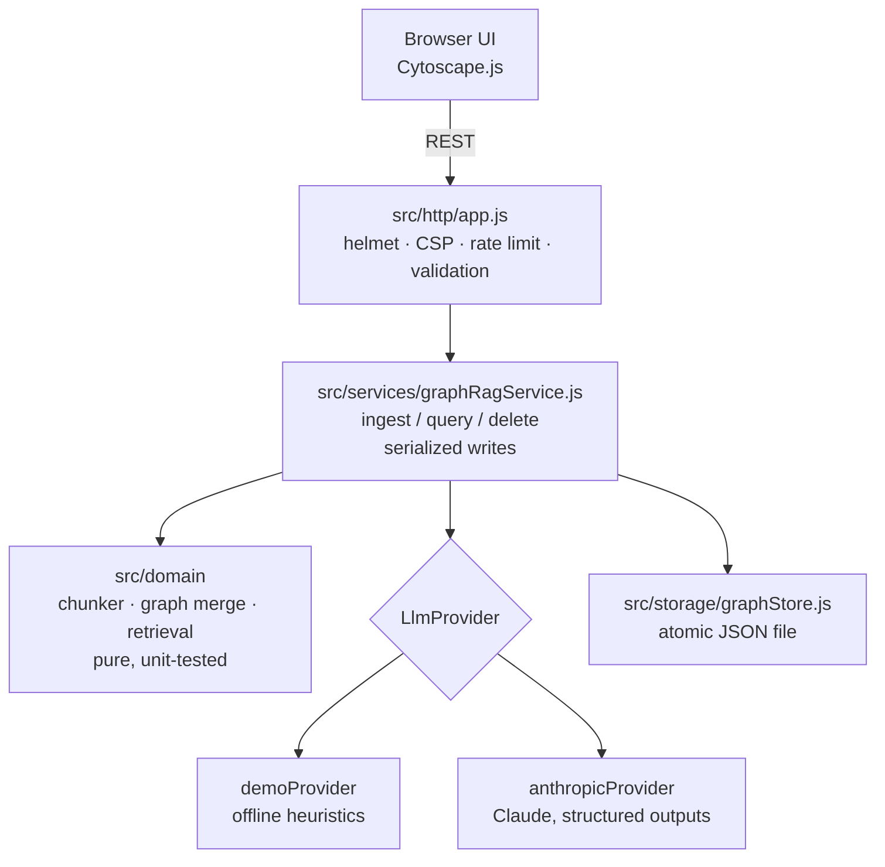

# GraphRAG Vision

GraphRAG Vision turns unstructured documents into a **knowledge graph** and answers questions from it, **citing the passages it used**. You can see and explore the graph in the browser: it is drawn with Cytoscape.js, query results are highlighted on it, and you can filter relations by year.

[](https://github.com/codebyjuliamendes/ai-graphrag-vision/actions/workflows/ci.yml)


## The problem

Vector-only RAG retrieves text chunks that look similar to a question. It struggles when the answer depends on how entities relate to each other ("how did the OmniTech acquisition affect NexCorp's results?"). GraphRAG first extracts the **entities and relations** from the documents. At question time it uses that graph to decide which passages matter, and then answers only from those passages, with citations.

## Features

- **Document ingestion**: you paste text or load a `.txt`/`.md` file. The text is split into chunks, and an LLM (or the offline demo provider) extracts entities and relations from each chunk. The results are merged into a single graph with de-duplicated entities.
- **Provenance everywhere**: every entity and relation records the chunks it came from. Answers cite them as `[n]` and show an excerpt of the supporting passage.
- **Hybrid retrieval**: the entities named in the question are expanded one hop through the graph. Chunks are then ranked with BM25 plus a boost for mentioning those entities, within a character budget.
- **Persisted graph**: the graph is stored as a JSON file and written atomically, so it survives restarts.
- **Temporal filter**: relations carry `valid_from` / `valid_until` years when the text states them, and the UI can filter the graph by year.
- **Pluggable providers**: Claude through the official Anthropic SDK, or a **clearly labelled offline demo mode** that needs no credentials.
- **Document management**: you can list documents and remove one, which also removes everything only that document supported. Identical uploads are de-duplicated.
- **API docs**: an OpenAPI 3 spec is served at `/swagger.json`, with Swagger UI at `/api-docs` (served locally, no CDN).

## Provider modes

| `LLM_PROVIDER`   | Extraction                                                                                | Answers                                                           | Needs credentials |
| ---------------- | ----------------------------------------------------------------------------------------- | ----------------------------------------------------------------- | ----------------- |
| `demo` (default) | Rule-based heuristics (capitalization, keyword lists, verb lexicon, years)                | Extractive: the most relevant retrieved sentences, with citations | No                |
| `anthropic`      | Claude (`ANTHROPIC_MODEL`, default `claude-opus-5-5`) with JSON-schema structured outputs | Claude, constrained to the numbered sources, with citations       | Yes               |

The UI shows a **"Demo mode · rule-based, no LLM"** badge, and every demo answer says that no language model was used. The demo heuristics work well on short, well-formed English business text such as the bundled fictional sample. Use `anthropic` for real documents.

With the Anthropic provider, requests opt into server-side refusal fallbacks (`fallbacks: "default"`). A refusal, a truncated response or malformed output becomes an explicit API error and never corrupts the graph: every provider output is validated with Zod before it is merged.

## Quick start

Requirements: Node.js 22 (or ≥ 20.19).

```bash
npm ci
npm start                # http://localhost:4001 (demo mode)
```

Open the app and click **Load sample report**, then ask, for example, _"Who acquired OmniTech?"_.

To use Claude:

```bash
cp .env.example .env     # then edit, or export the variables
LLM_PROVIDER=anthropic ANTHROPIC_API_KEY=sk-ant-... npm start
```

The app does not load `.env` by itself. Export the variables, use `node --env-file=.env server.js`, or use Docker Compose.

### Docker

```bash
docker compose up --build                      # demo mode on http://localhost:4001
LLM_PROVIDER=anthropic ANTHROPIC_API_KEY=... docker compose up --build
```

The image is multi-stage, runs as the non-root `node` user, has a `HEALTHCHECK` and keeps the graph in the `/app/data` volume.

## Configuration

All variables are validated at boot. An invalid value stops the process and lists every problem. See [`.env.example`](.env.example).

| Variable                                                            | Default               | Description                                                                                |
| ------------------------------------------------------------------- | --------------------- | ------------------------------------------------------------------------------------------ |
| `PORT` / `HOST`                                                     | `4001` / `0.0.0.0`    | HTTP listener                                                                              |
| `LOG_LEVEL`                                                         | `info`                | pino level (`silent` … `trace`)                                                            |
| `LLM_PROVIDER`                                                      | `demo`                | `demo` or `anthropic`                                                                      |
| `ANTHROPIC_API_KEY`                                                 | –                     | Used by the Anthropic SDK (other SDK credential sources also work)                         |
| `ANTHROPIC_MODEL`                                                   | `claude-opus-5-5`     | Claude model id                                                                            |
| `LLM_TIMEOUT_MS`                                                    | `120000`              | Per-request LLM timeout                                                                    |
| `DATA_DIR`                                                          | `./data`              | Where `graph.json` is stored                                                               |
| `MAX_DOCUMENT_CHARS`                                                | `200000`              | Maximum document size                                                                      |
| `CHUNK_SIZE`                                                        | `1200`                | Maximum characters per chunk                                                               |
| `RETRIEVAL_TOP_K` / `MAX_CONTEXT_CHARS`                             | `6` / `12000`         | Retrieval limits (context budget)                                                          |
| `EXTRACTION_CONCURRENCY`                                            | `3`                   | Parallel extraction calls per document                                                     |
| `API_TOKEN`                                                         | –                     | If set (≥ 16 chars), adding or removing documents requires `Authorization: Bearer <token>` |
| `CORS_ORIGIN`                                                       | –                     | Comma-separated origins allowed to call `/api`. Empty means same-origin only               |
| `TRUST_PROXY`                                                       | `0`                   | Number of proxy hops to trust (set `1` behind an ingress)                                  |
| `RATE_LIMIT_WINDOW_MS` / `RATE_LIMIT_WRITES` / `RATE_LIMIT_QUERIES` | `60000` / `10` / `60` | Per-IP rate limits                                                                         |
| `SHUTDOWN_TIMEOUT_MS`                                               | `10000`               | Grace period for shutdown on SIGTERM                                                       |

## API

| Method   | Path                    | Description                                                                                |
| -------- | ----------------------- | ------------------------------------------------------------------------------------------ |
| `GET`    | `/healthz`, `/readyz`   | Liveness / readiness                                                                       |
| `GET`    | `/api/status`           | Provider, limits, graph counters                                                           |
| `GET`    | `/api/graph`            | Graph as Cytoscape elements                                                                |
| `GET`    | `/api/documents`        | Indexed documents                                                                          |
| `POST`   | `/api/documents`        | `{ title, text }`: index a document (201, or 200 if already indexed)                       |
| `DELETE` | `/api/documents/:id`    | Remove a document                                                                          |
| `POST`   | `/api/process-document` | Index the bundled fictional sample (kept for backwards compatibility)                      |
| `POST`   | `/api/query`            | `{ query }` returns `{ answer, citations[], highlightedNodes[], facts[], provider, demo }` |

Errors always have the shape `{ "success": false, "error": "<message>", "code": "<CODE>" }`.

## Architecture



- **`src/domain`**: pure functions with no I/O (chunking, entity/relation merging with provenance, document removal, BM25 + graph retrieval, Zod schemas).
- **`src/providers`**: the `LlmProvider` contract (`extract`, `answer`) and its two implementations. Provider output is treated as untrusted and validated.
- **`src/services`**: orchestration. Mutations go through a queue, so concurrent uploads never lose updates. A failed ingestion leaves the graph unchanged.
- **`src/http`**: Express 5 wiring, security headers, error mapping and static assets (Cytoscape and Swagger UI are served from `node_modules`, not CDNs).
- **`server.js`**: boot (config, logger, service, listen) and graceful shutdown on SIGTERM/SIGINT.

### Decisions and trade-offs

- **A JSON file instead of a graph database** keeps the project dependency-free and easy to run. It is single-writer by design, so the Kubernetes manifest runs **one replica** with a PVC. Neo4j or Postgres would be the next step for multi-instance deployments.
- **Lexical (BM25) + graph retrieval, no embeddings**: deterministic, offline and testable. Embedding-based retrieval could be added behind the same retrieval function.
- **Strict CSP** (`script-src 'self'`, `style-src 'self'`): the UI is plain HTML/CSS/JS without a build step, and all dynamic text is inserted with `textContent`.

## Development

```bash
npm run dev           # watch mode
npm test              # node:test unit + API integration tests (LLM mocked)
npm run lint          # ESLint
npm run format:check  # Prettier
npm run typecheck     # tsc --checkJs over JSDoc types
npm run check         # all of the above
```

CI (GitHub Actions) runs lint, format, typecheck, tests and `npm audit`. It then builds the Docker image, waits for its health check and smoke-tests the API inside the container.

## Deployment

- **Docker / Compose**: see above.
- **Kubernetes**: `kubectl apply -f k8s/` creates a Deployment (1 replica, non-root, read-only root FS, probes on `/healthz` and `/readyz`), a PVC, a Service and an nginx Ingress. Before applying, push the image to your registry and update `image:` in `k8s/deployment.yaml`. For Claude and/or a write token, create the optional secret:
  `kubectl create secret generic ai-graphrag-vision --from-literal=ANTHROPIC_API_KEY=... --from-literal=API_TOKEN=...` and set `LLM_PROVIDER=anthropic`.

## Limitations

- The demo provider is heuristic. It misses entities that are not capitalized, can misclassify types and only finds relations between adjacent mentions in a sentence.
- Inputs are text only (no PDF or image parsing yet). Paste extracted text or use `.txt`/`.md` files.
- Without `API_TOKEN`, anyone who can reach the server can add and remove documents. Set a token, or put the app behind authentication, before exposing it publicly.
- The rate limiter keeps its counters in memory, per process.
- Answers from Claude are constrained to the retrieved sources and cite them, but you should still verify important claims against the cited passages.

## License

[MIT](LICENSE) © Júlia Mendes
